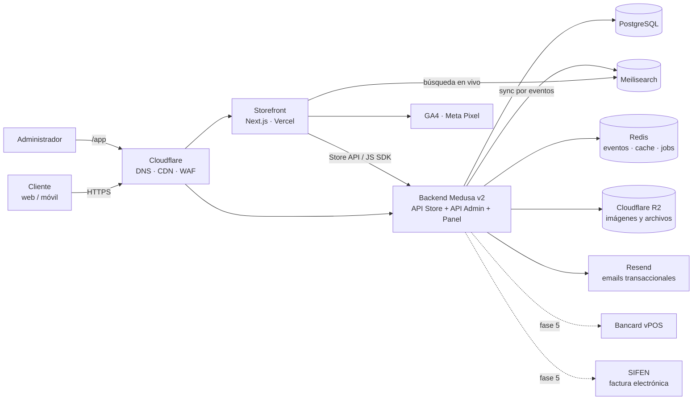

# Mandi'o: arquitectura de la tienda online

> Versión 1 · 2026-11-20 · Fase de planificación
> Referencia funcional: verdadconsecuencia.com.py (se copian las funciones, no la marca ni el diseño)

---

## 1. Decisiones tomadas

| Tema | Decisión |
|---|---|
| Enfoque | Desarrollo a medida (opción B) |
| Nombre | **Mandi'o**. Slug técnico: `mandio`. Dominio sugerido: `mandio.com.py` |
| Mercado | Paraguay. Español con voseo. Moneda PYG (₲) sin decimales |
| Pagos al lanzar | Sin Bancard todavía. Se arranca con **transferencia, contra entrega y pedido por WhatsApp**. Bancard se agrega después como un proveedor más, sin rehacer el checkout |
| Catálogo | Multi-categoría ("de todo tipo"), árbol de hasta 3 niveles y variantes (talle, color, etc.) |

---

## 2. Vista general



**Principio:** el storefront no tiene lógica de negocio propia. Precios, stock, promociones y pedidos viven en Medusa. Next.js solo muestra los datos y orquesta el flujo.

---

## 3. Stack

| Capa | Tecnología | Por qué |
|---|---|---|
| Storefront | **Next.js (App Router) + TypeScript + Tailwind CSS** | SSR e ISR para SEO, `next/image` para WebP y server actions |
| Componentes UI | shadcn/ui (Radix) | Accesible y personalizable con la marca Mandi'o |
| Backend ecommerce | **Medusa v2** (Node.js, TypeScript) | Trae productos, variantes, stock, pedidos, clientes, promociones y panel de administración |
| Base de datos | **PostgreSQL 16** | La que requiere Medusa |
| Cache / eventos | **Redis** | Event bus, workflows y cache de Medusa |
| Búsqueda | **Meilisearch** | Búsqueda en vivo, tolerancia a errores de tipeo, facetas y filtros |
| Archivos | **Cloudflare R2** (compatible con S3) | Imágenes de productos, banners y CVs. Sin costo de salida |
| Emails | **Resend** + React Email | Confirmación de pedido y recuperación de contraseña |
| Monorepo | **pnpm + Turborepo** | Storefront, backend y paquetes compartidos en un solo repo |
| Calidad | ESLint, Prettier, Vitest, Playwright | Tests unitarios y E2E del flujo de compra |
| CI/CD | GitHub Actions | Lint, tests, build y deploy |
| Hosting | Vercel (storefront) + VPS con Docker Compose (backend, Postgres, Redis, Meilisearch) | Bajo costo. Alternativa sin administrar servidor: Railway |

---

## 4. Estructura del repositorio

```
mandio/
├─ apps/
│  ├─ storefront/              # Next.js
│  │  ├─ app/
│  │  │  ├─ (tienda)/          # páginas públicas
│  │  │  ├─ (cuenta)/          # requieren login
│  │  │  ├─ checkout/
│  │  │  └─ api/               # webhooks y revalidación ISR
│  │  ├─ components/
│  │  ├─ lib/medusa/           # cliente JS SDK y data fetching
│  │  └─ lib/search/           # cliente Meilisearch
│  └─ backend/                 # Medusa v2
│     ├─ src/modules/          # módulos propios (ver §6)
│     ├─ src/providers/        # pagos y envíos (ver §8 y §9)
│     ├─ src/subscribers/      # sync a Meilisearch, emails
│     ├─ src/workflows/
│     ├─ src/api/              # rutas store/admin personalizadas
│     ├─ src/admin/            # widgets y páginas extra del panel
│     └─ medusa-config.ts
├─ packages/
│  ├─ ui/                      # componentes compartidos
│  ├─ config/                  # eslint, tsconfig, tailwind preset
│  └─ types/
├─ infra/
│  ├─ docker-compose.yml       # local: postgres, redis, meilisearch
│  └─ docker-compose.prod.yml
└─ docs/
```

---

## 5. Correspondencia con la referencia

| Función de la referencia | Cómo lo resuelve Mandi'o |
|---|---|
| Árbol de categorías de 3 niveles y mega menú | Medusa **Product Categories** (anidadas, con `handle` y orden) |
| Variantes (talle P/M/G, color) | Product **Options y Variants**, cada una con su SKU y stock |
| Precio tachado y badge -49% | **Price Lists** de tipo *sale*. El badge se calcula como `(original − actual) / original` |
| Sección Descuentos | Colección o categoría "Ofertas" generada a partir de las price lists activas |
| Stock ("17 disponibles") | **Inventory Module** + **Stock Locations** |
| 9 sucursales | Stock Locations (retiro en tienda) + módulo `branch` (horarios, mapa) |
| Cupones | **Promotion Module** (código, %, monto fijo, envío gratis, mínimo de compra) |
| Gift cards de monto fijo | Módulo propio `gift-card` (ver §6) |
| Wishlist sin login | Módulo propio `wishlist` + `localStorage`, que se fusiona al iniciar sesión |
| Carrito y mini-carrito | Medusa **Cart**. El id va en una cookie httpOnly |
| Cuenta, login y recuperar contraseña | Medusa **Customer + Auth** (email y contraseña). Google opcional |
| Búsqueda con overlay en vivo | Meilisearch desde el storefront (búsqueda mientras se escribe) |
| Filtros y orden | Facetas de Meilisearch: categoría, precio, talle, color, en oferta, disponibilidad |
| Home editable (banners, colecciones) | Módulo propio `cms` con páginas en el panel admin |
| Sucursales, contacto, devoluciones | Páginas del storefront con contenido del módulo `cms` / `branch` |
| Trabajá con nosotros (CV hasta 2MB) | Módulo propio `job-application` + subida de archivos a R2 |
| Página de mantenimiento | Flag en el middleware de Next.js |

**Mejoras sobre la referencia:**
- Botón de WhatsApp en la ficha y flotante.
- Reseñas con estrellas (fase 6).
- Páginas de Envíos, FAQ y Términos.
- Datos estructurados de producto (JSON-LD).
- Ocultar las categorías vacías.
- Impedir que se publiquen productos en papelera.

---

## 6. Módulos propios del backend

| Módulo | Modelos | Notas |
|---|---|---|
| `wishlist` | `Wishlist(customer_id)`, `WishlistItem(variant_id)` | Para invitados vive en el navegador y se fusiona al iniciar sesión |
| `gift-card` | `GiftCard(code, initial_amount, balance, status, expires_at, order_id)` | Se vende como producto ("Gift Card ₲300.000"). Al pagarse se genera el código y se envía por email. En el checkout se canjea como saldo |
| `branch` | `Branch(name, address, maps_url, hours[], phone, stock_location_id, pickup_enabled)` | Página de sucursales y retiro en tienda |
| `cms` | `Banner`, `HomeSection(type, title, category_id/collection_id, order)`, `Page(slug, title, content)` | Home e institucional editables sin deploy |
| `job-application` | `JobApplication(name, email, phone, position, cv_file_url)` | Validación: pdf/doc/docx, máximo 2MB |
| `py-customer-data` | Campos extra del cliente y el pedido: `document_type (CI/RUC)`, `document_number`, `business_name` | Para facturación y encomiendas |

Cada módulo se relaciona con los módulos core mediante **Module Links** de Medusa, sin modificar las tablas core.

---

## 7. Storefront: rutas

| Ruta | Render | Contenido |
|---|---|---|
| `/` | ISR (60s) | Home: categorías, banners, novedades, secciones por categoría |
| `/tienda` | ISR + streaming | Todo el catálogo con filtros (talle, color, precio, ofertas, stock), orden y paginación de 24 |
| `/c/[handle]` | ISR + streaming | Listado por categoría (incluye subcategorías), por ejemplo `/c/ropa-mujer-blusas`. Breadcrumbs con la ruta completa |
| `/p/[handle]` | ISR + revalidación al editar | Ficha de producto |
| `/buscar?q=` | SSR | Resultados de Meilisearch |
| `/ofertas` | ISR | Productos con descuento |
| `/gift-card` | ISR | Gift cards |
| `/carrito` | Dinámico | Carrito, cupón, estimación de envío |
| `/checkout` | Dinámico | Pasos: Datos → Envío → Pago → Revisión |
| `/pedido/[id]` | Dinámico | Confirmación e instrucciones de pago |
| `/cuenta`, `/cuenta/pedidos`, `/cuenta/direcciones` | Dinámico (protegido) | Área de cliente |
| `/ingresar`, `/registro`, `/recuperar` | Dinámico | Autenticación |
| `/favoritos` | Cliente | Wishlist |
| `/sucursales`, `/contacto`, `/envios`, `/devoluciones`, `/preguntas-frecuentes`, `/terminos`, `/privacidad`, `/trabaja-con-nosotros` | ISR | Institucional |

- **Revalidación:** un subscriber de Medusa (`product.updated`, etc.) llama a `/api/revalidate` con un secreto, así un cambio de precio se ve al instante.
- **Mobile first:** el menú móvil usa un drawer, el carrito un side-drawer y los filtros una hoja inferior.

---

## 8. Checkout para Paraguay

**Paso 1: Datos**
- Nombre, apellido, email y teléfono (formato `09XX XXX XXX`).
- ¿Necesita factura? Si la respuesta es sí: RUC y razón social. Si no: CI.

**Paso 2: Envío** (*Fulfillment Providers* propios)

| Opción | Regla |
|---|---|
| Retiro en sucursal | Gratis. Se elige la sucursal y solo se muestran las que tienen stock |
| Delivery Asunción y Gran Asunción | Tarifa por zona o ciudad (tabla editable en el admin). Envío gratis desde un monto configurable |
| Encomienda al interior | Tarifa por departamento. Se pide la agencia (NSA, etc.) y la CI de quien recibe |

- Dirección: departamento → ciudad → barrio, calle, número, referencia.
- Ubicación en el mapa: opcional (pin de Google Maps o un enlace).

**Paso 3: Pago** (*Payment Providers*, ver §9)

**Paso 4: Revisión y confirmación.** Se crea el pedido, se envía el email y se muestra la pantalla de "Gracias".

---

## 9. Pagos: diseño en fases

Todos los métodos implementan la interfaz de **Payment Provider** de Medusa. Agregar Bancard después no toca el checkout.

| Fase | Método | Flujo |
|---|---|---|
| Lanzamiento | **Transferencia bancaria** | El pedido queda en "pago pendiente". Se muestran los datos bancarios y el cliente sube el comprobante (a R2). El admin lo aprueba y el pedido pasa a "pagado" |
| Lanzamiento | **Contra entrega** (efectivo o POS del delivery) | El pago se autoriza y se captura al entregar |
| Lanzamiento | **Coordinar por WhatsApp** | Se crea el pedido y se abre `wa.me/595…` con el número y el detalle del pedido |
| Lanzamiento | **Gift card** | Descuenta saldo y se puede combinar con otro método |
| Fase 5 | **Bancard vPOS 2.0** | `single_buy` → `process_id` → iframe de Bancard → webhook de confirmación → pedido pagado. Requiere contrato de comercio, RUC y credenciales de staging |
| Futuro | Pagopar / QR / billeteras | Mismo patrón de provider |

**Para tramitar Bancard en paralelo:** RUC activo, cuenta bancaria comercial, web publicada con términos, política de devoluciones y datos de contacto visibles (Bancard lo revisa).

---

## 10. Estados del pedido

```
pendiente_pago → pagado → preparando → listo_para_retiro / enviado → entregado
        ↘ cancelado (expira a las 48h sin pago; libera el stock)
entregado → cambio_solicitado → cambio_resuelto (nota de crédito / reemplazo)
```

- Cada cambio de estado manda un email al cliente. En el futuro también podrá avisar por WhatsApp con plantilla.
- La política de cambios es de 2 días desde la recepción, igual que en la referencia, y es configurable.

---

## 11. Búsqueda y filtros (Meilisearch)

- **Índice `products`:** título, descripción, SKU, categorías (con su jerarquía), opciones (talle, color), precio actual, precio original, `on_sale`, `in_stock`, `created_at`, popularidad (ventas).
- **Sincronización:** subscribers de `product.*`, `price` e `inventory`. Además hay un job nocturno de reindexado completo.
- **Facetas:** categoría, rango de precio, talle, color, en oferta, disponible.
- **Orden:** relevancia, novedades, popularidad, precio ↑ y precio ↓.
- **Tipeo:** sinónimos ("remera = camiseta", "celu = celular") y tolerancia a errores.

---

## 12. SEO, analítica y legal

- **URLs:** slugs en español, `sitemap.xml` dinámico, `robots.txt`, etiqueta canonical, OpenGraph por producto.
- **JSON-LD:** `Product`, `Offer` (PYG), `BreadcrumbList` y `Organization`. Las sucursales usan `LocalBusiness`.
- **Analítica:** GA4 con eventos de ecommerce (`view_item`, `add_to_cart`, `begin_checkout`, `purchase`) y Meta Pixel, ambos tras un banner de consentimiento.
- **Legal:** términos, privacidad (Ley 6534/2020 de protección de datos crediticios y buenas prácticas) y devoluciones (Ley 1334/98 de defensa del consumidor).
- **Factura electrónica:** **SIFEN (DNIT)** queda para la fase 5, con un proveedor de facturación vía API. El modelo de datos ya guarda RUC y razón social desde el día 1.

---

## 13. Infraestructura y entornos

| Entorno | Storefront | Backend + datos |
|---|---|---|
| Local | `pnpm dev` en :8000 | `pnpm infra:up` (Postgres :5433, Redis :6379, Meilisearch :7700) + `medusa develop` en :9000 |
| Staging | Vercel Preview | VPS staging / Railway |
| Producción | Vercel (dominio `mandio.com.py`) | VPS con Docker Compose y Caddy (HTTPS) en `api.mandio.com.py`. Panel en `api.mandio.com.py/app` |

- Cloudflare para DNS, proxy, WAF y rate limit en `/auth` y `/store/carts`.
- Backups diarios de Postgres a R2, con retención de 14 días.
- Monitoreo con Sentry (errores en front y back) y UptimeRobot.
- Variables de entorno y secretos en Vercel y GitHub, nunca en el repo.

---

## 14. Seguridad

- El panel admin tiene usuarios con roles y contraseñas fuertes.
- El backend solo acepta CORS del dominio del storefront.
- Las cookies son httpOnly, Secure y SameSite=Lax.
- Los archivos subidos (CV, comprobantes) se validan por tipo y tamaño y se guardan en un bucket privado con URL firmada.
- Los webhooks de pago verifican firma o token. Las operaciones son idempotentes.
- Las dependencias se actualizan con Dependabot.

---

## 15. Plan por fases

| Fase | Entregable | Incluye |
|---|---|---|
| **0 · Base** | Monorepo funcionando | Turborepo, Docker local, Medusa con región Paraguay/PYG, Next.js con marca básica, CI |
| **1 · Catálogo** | Se puede navegar la tienda | Categorías, productos y variantes, imágenes en R2, home, listados, ficha, Meilisearch con búsqueda en vivo y filtros, importación de productos por CSV |
| **2 · Compra** | Se puede comprar | Carrito, cupones, checkout PY, envíos (retiro, delivery, encomienda), pagos por transferencia, contra entrega y WhatsApp, emails, estados del pedido |
| **3 · Cliente** | Fidelización | Cuenta, historial, direcciones, wishlist, gift cards |
| **4 · Contenido** | Lanzamiento público | Módulo CMS, sucursales, páginas institucionales, Trabajá con nosotros, SEO, analítica, legal, deploy a producción |
| **5 · Pagos y factura** | Bancard y SIFEN | Provider de Bancard vPOS y facturación electrónica |
| **6 · Mejoras** | Crecimiento | Reseñas, notificaciones por WhatsApp, recomendaciones, reportes de ventas, cuotas |

---

## 16. Pendientes de definir

1. ¿Mandi'o tendrá **sucursales físicas** o puntos de retiro? Si no, se desactiva el retiro y el módulo `branch` queda solo informativo.
2. Zonas y **tarifas de delivery**, y qué agencias de encomienda se usan.
3. **Identidad visual:** logo, paleta y tipografía.
4. ¿Hay **catálogo inicial**? Cantidad aproximada de productos y formato (Excel u otro sistema).
5. Datos bancarios para transferencia y número de WhatsApp de ventas.
6. Dominio: confirmar que `mandio.com.py` esté libre (se registra en NIC.py).
